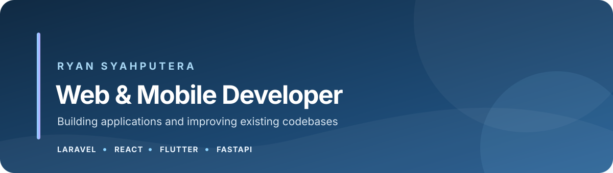

  

  <strong>Web &amp; Mobile Developer · Padang, Indonesia</strong> 
  I build web, mobile, and backend applications—and improve codebases that are already in use. 
  <a href="https://rynsp.github.io/">Portfolio</a> ·
  <a href="https://www.linkedin.com/in/ryan-syahputera">LinkedIn</a> ·
  <a href="mailto:ryan93sp@gmail.com">Email</a>

---

### About Me

- I develop web and mobile applications, backend services, and REST APIs.
- I work across new features, maintenance, and refactoring existing systems.
- Open to freelance projects and remote collaboration.

### Tech Stack

### Selected Projects

- **ShipBoard** — A collaboration platform for team workspaces, projects, roadmaps, and tasks, with Laravel and Flutter clients.
- **IntraPDF** — A web application for PDF workflows, built with React, TypeScript, and FastAPI.
- **SimplePos Offline** — Point-of-sale and inventory workflows across a CodeIgniter web application and Flutter mobile app.
- **Pocketstep Studio** — A bilingual application catalog and publishing platform.
- **Solok Terpadu & Solok Diujung Jari** — Public information and service portals for the City of Solok.
- **Palado** — Continued development and refactoring of an existing application originally built by another developer.

### Get in Touch

- **Portfolio:** [rynsp.github.io](https://rynsp.github.io/)
- **LinkedIn:** [Ryan Syahputera](https://www.linkedin.com/in/ryan-syahputera)
- **Email:** [ryan93sp@gmail.com](mailto:ryan93sp@gmail.com)

---

Thanks for visiting my profile.

